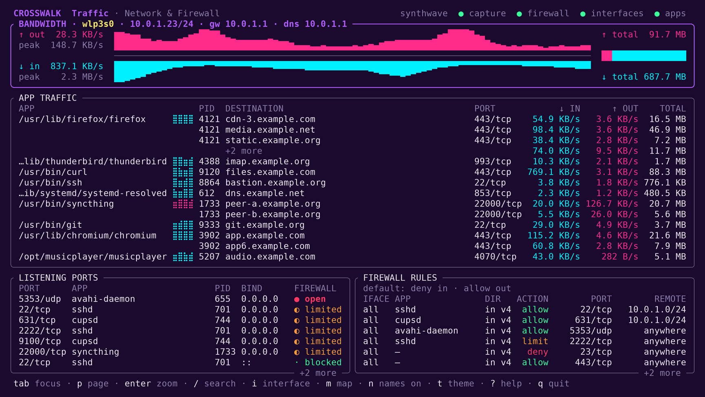
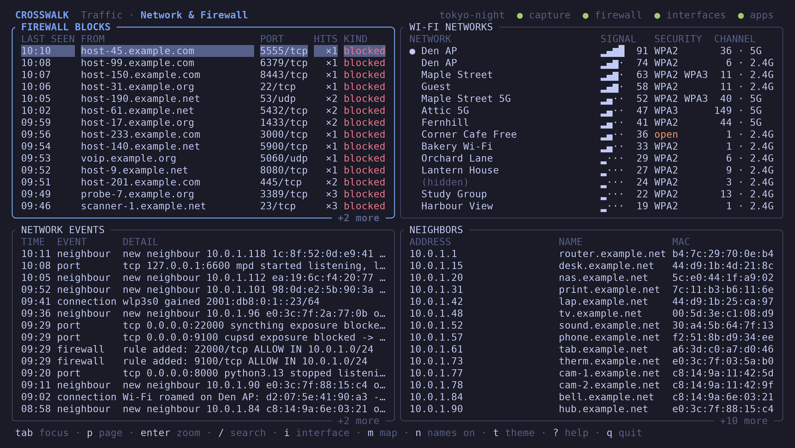
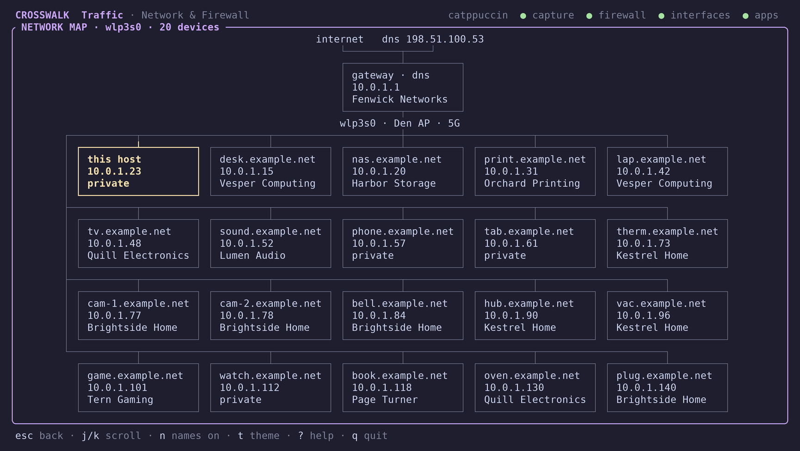

# Crosswalk

Crosswalk shows what your Linux machine is doing on the network, live, in one terminal window.

See how much bandwidth you are using, which apps are talking to which hosts, which ports are open and whether UFW lets traffic reach them, what the firewall has blocked, and which machines and Wi-Fi networks are nearby. Switch between 25 built-in themes with one key.

Crosswalk only watches. It never changes a firewall rule and never writes traffic history to disk.







The screenshots use made-up data, in the synthwave, tokyo-night and catppuccin themes.

## Requirements

- Linux, Rust and Cargo (edition 2024), and a C toolchain.
- libpcap development files (`libpcap-dev` on Debian and Ubuntu).
- Packet-capture privilege: run with `sudo`, or grant two capabilities once (see [Running without sudo](#running-without-sudo)).
- UFW and `journalctl` for the firewall panes. Crosswalk reads UFW's files and never runs `ufw`.
- `ip` (iproute2) for Neighbors.
- Optional: `nmcli` (NetworkManager) for Wi-Fi Networks.

Tested with Arch Linux (Linux 7.2.9), Rust 1.98.1, libpcap 1.11.0, UFW 0.36.2, NetworkManager 1.58.1, iproute2 7.2.0 and systemd 262. Other versions may work but have not been tried.

## Install

```sh
cargo install crosswalk
sudo ~/.cargo/bin/crosswalk
```

`cargo install` builds the release binary into `~/.cargo/bin/crosswalk`. Run it by its full path, because `sudo` does not search `~/.cargo/bin`. After the `setcap` grant below, plain `crosswalk` works.

Remove it with `cargo uninstall crosswalk`. An installed copy has no capabilities, so grant them again after every install.

To build from a clone:

```sh
git clone https://github.com/terminusarchive/crosswalk
cd crosswalk
cargo build --release
sudo ./target/release/crosswalk
```

Use `--config config.example.toml` for a configuration file. Command-line options override the file. The terminal must be at least 110 columns by 24 rows.

## Running without sudo

Crosswalk needs privilege to capture packets and to see which process owns another user's socket. Grant just those to the binary once, then run it as yourself:

```sh
sudo setcap cap_net_raw,cap_sys_ptrace+ep <path to the crosswalk binary>
```

Crosswalk does not run `setcap` for you. Without `cap_net_raw` it prints this command and exits. Replacing the file clears the grant, so repeat the command after each build or install.

- `cap_net_raw` lets Crosswalk capture packets.
- `cap_sys_ptrace` lets it name other users' programs. It can read and control any process, root's included, so it is close to root-equivalent. Grant it only to a binary you trust.

`cap_net_raw` alone works. Other users' programs are then counted as not attributed.

The grant belongs to the file. Anyone who can write to the file can run their own code with these capabilities. For a hardened install, copy the binary to a root-owned place first:

```sh
sudo groupadd crosswalk
sudo usermod -aG crosswalk "$USER"
sudo install -o root -g crosswalk -m 0750 target/release/crosswalk /usr/local/bin/crosswalk
sudo setcap cap_net_raw,cap_sys_ptrace+ep /usr/local/bin/crosswalk
```

The group takes effect at your next login. Repeat `install` and `setcap` after each build. Remove the grant with `sudo setcap -r <path>`.

The capabilities do not grant access to the kernel journal or to UFW's rule files. The [manual](docs/manual.md#what-you-are-granting) covers both, and what you see when each capability is missing.

## Keys

| Key | Action |
| --- | --- |
| `Tab` / `Shift-Tab` | Next or previous pane |
| `p` | Other page |
| `1`–`8` | Go to a pane |
| `Enter` / `Esc` | Zoom the pane / leave zoom |
| `j` `k` or `↓` `↑` | Move the selection |
| `/` | Search the pane |
| `m` | Network map |
| `i` | Next interface in Bandwidth |
| `n` | Reverse-DNS names on or off |
| `t` / `T` | Next or previous theme |
| `r` | Wi-Fi scan (the one key that transmits) |
| `?` | Help |
| `q` | Quit |

## Panes

Traffic page:

- **Bandwidth** (`1`): download and upload for one interface, as a chart.
- **App Traffic** (`2`): each app's destinations, with rates and totals.
- **Listening Ports** (`3`): local ports, their owners, and whether UFW lets traffic in.
- **Firewall Rules** (`4`): UFW's default policies and rules.

Network & Firewall page:

- **Firewall Blocks** (`5`): inbound packets UFW or the kernel refused.
- **Network Events** (`6`): changes in rules, ports, neighbours and connections.
- **Wi-Fi Networks** (`7`): access points in range.
- **Neighbors** (`8`): machines this computer has recently talked to.

## More

- [docs/manual.md](docs/manual.md): every key and pane in full, the network map, limits, colours and themes, and a smoke checklist.
- [docs/firewall.md](docs/firewall.md): firewall setup, sources and diagnostics.

## Licence

MIT. See [LICENSE](LICENSE).
